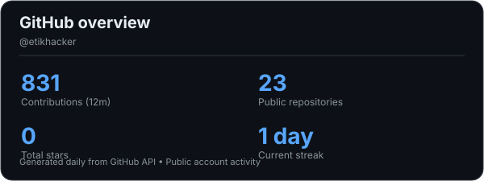
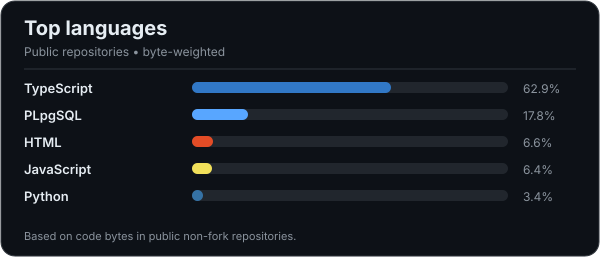

# Hi, I'm Omar Babayev 👋

**Full-Stack Developer · AI Engineering Enthusiast · AI-Assisted / Vibe Coding**

I'm an **Information Technology student at Mingachevir State University (2024–2028)**, based in Azerbaijan. I build web applications and AI-assisted products with a focus on practical functionality, user experience, and maintainable architecture.

I use **vibe coding** to accelerate development, while taking code quality, testing, data security, and deployment seriously.

  
  
  

---

## 👨‍💻 About Me

- 🚀 **Full-Stack Development:** Building responsive products with React, Next.js, TypeScript, FastAPI, and Supabase.
- 🤖 **AI Engineering:** Exploring AI integrations, API-based automation, intelligent workflows, and practical AI applications.
- 🧠 **Vibe Coding:** Using AI-assisted development to move from ideas to working software, then reviewing and improving the results.
- 🔐 **Engineering Mindset:** Interested in backend architecture, PostgreSQL, row-level security (RLS), testing, and reliable deployments.
- 🎓 **Education:** BSc in Information Technology, Mingachevir State University (2024–2028).

## 🛠️ Tech Stack

  

| Area | Technologies & Practices |
| --- | --- |
| **Frontend** | Next.js, React, TypeScript, JavaScript, Tailwind CSS, HTML, CSS |
| **Backend & APIs** | Python, FastAPI, Node.js, REST APIs |
| **Database & Auth** | PostgreSQL, Supabase, Supabase Auth, Row-Level Security (RLS) |
| **AI & Automation** | OpenAI, Claude, Gemini, AI API integration, prompt engineering |
| **Workflow & Deployment** | Git, GitHub, Vercel, testing, debugging, AI-assisted development |

## 🚀 Featured Projects

<table>
  <tr>
    <td width="50%" valign="top">
      <h3>🎓 Talora</h3>
      
A student internship and career-development platform with applications, assignments, feedback, progress tracking, and certificates.

      
<code>Next.js</code> <code>TypeScript</code> <code>Supabase</code>

      
<a href="https://talora-az.vercel.app">Live website</a> · <a href="https://github.com/etikhacker/Talora.az">Source code</a>

    </td>
    <td width="50%" valign="top">
      <h3>📅 E-Cədvəl</h3>
      
A multi-tenant university scheduling platform for organizing academic timetables and groups.

      
<code>Next.js</code> <code>TypeScript</code> <code>Supabase</code>

      
<a href="https://e-cedvel.vercel.app">Live website</a> · <a href="https://github.com/etikhacker/e-cedvel">Source code</a>

    </td>
  </tr>
  <tr>
    <td width="50%" valign="top">
      <h3>⚡ Energy Platform / EkoAI</h3>
      
An AI-assisted energy monitoring project focused on resource awareness and more sustainable energy use.

      
<code>Web App</code> <code>AI Integration</code> <code>Energy</code>

      
<a href="https://energy-platform-beta.vercel.app">Live website</a> · <a href="https://github.com/etikhacker/energy-platform">Source code</a>

    </td>
    <td width="50%" valign="top">
      <h3>🏙️ CityAI</h3>
      
A civic technology project for submitting and analyzing city-related reports using AI-assisted image understanding.

      
<code>AI Vision</code> <code>Web App</code> <code>Civic Tech</code>

      
<a href="https://cityai-asan.vercel.app">Live website</a> · <a href="https://github.com/etikhacker/cityai">Source code</a>

    </td>
  </tr>
  <tr>
    <td width="50%" valign="top">
      <h3>🏠 RentHome AZ</h3>
      
A rental property discovery platform designed to make browsing listings and finding homes easier.

      
<code>Web Development</code> <code>UI/UX</code>

      
<a href="https://rent-home-az.vercel.app">Live website</a> · <a href="https://github.com/etikhacker/RentHome-AZ">Source code</a>

    </td>
    <td width="50%" valign="top">
      <h3>🌐 Personal Portfolio</h3>
      
A responsive, bilingual developer portfolio featuring selected projects, technical skills, and contact information.

      
<code>HTML</code> <code>CSS</code> <code>JavaScript</code>

      
<a href="https://portfolio-omar-babayev.vercel.app">Live website</a> · <a href="https://github.com/etikhacker/portfolio">Source code</a>

    </td>
  </tr>
</table>

## 💼 Professional Experience

| Role | Organization | Period |
| --- | --- | --- |
| **Python Programming Intern** | CodeAlpha | Aug–Sep 2026 |
| **Backend AI Engineering Intern** | FlyRank AI | 2026 |
| **Web Development Intern** | Thiranex (project-based, remote) | Aug–Sep 2026 |
| **IT Volunteer** | ASAN Xidmət | 2026 |

## 📚 Web Development Lessons & Learning

I also work on **practical web development lessons**, focusing on HTML, CSS, JavaScript, responsive layouts, and frontend fundamentals. I apply these concepts to hands-on projects and continue developing my skills in React, Next.js, and full-stack application development.

**Learning focus:** Building accessible interfaces, integrating APIs, understanding client/server architecture, and following Git-based workflows.

## 🏅 Certifications & Training

- **Meta** — Programming in Python (Coursera)
- **IBM** — Introduction to Cybersecurity Tools & Cyberattacks (Coursera)
- **HP LIFE** — Critical Thinking in the AI Era
- **Holberton School** — AI for Developers
- **Code Academy** — AI Literacy & Foundation *(in progress)*

## 📊 GitHub Activity

  
  

Stats are regenerated daily via GitHub Actions and hosted in this repository. The language chart uses public, non-fork repositories.

## 🐍 Contribution Activity

  <picture>
    <source media="(prefers-color-scheme: dark)" srcset="https://raw.githubusercontent.com/etikhacker/etikhacker/output/github-contribution-grid-snake-dark.svg" />
    
  </picture>

---

  <strong>Building useful software, learning continuously, and exploring what's possible with AI.</strong> 
  <a href="https://www.linkedin.com/in/omar-babayev-21888437b">LinkedIn</a> ·
  <a href="https://portfolio-omar-babayev.vercel.app">Portfolio</a> ·
  <a href="https://github.com/etikhacker?tab=repositories">Repositories</a>

